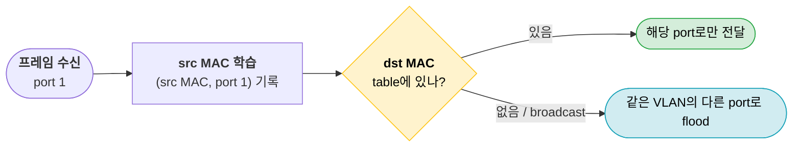
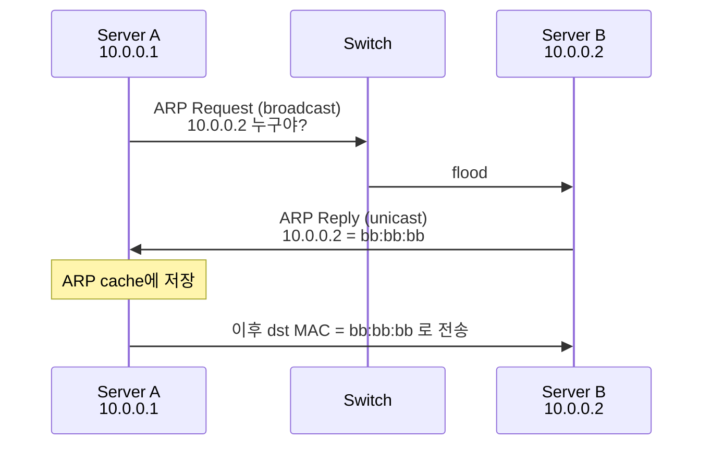
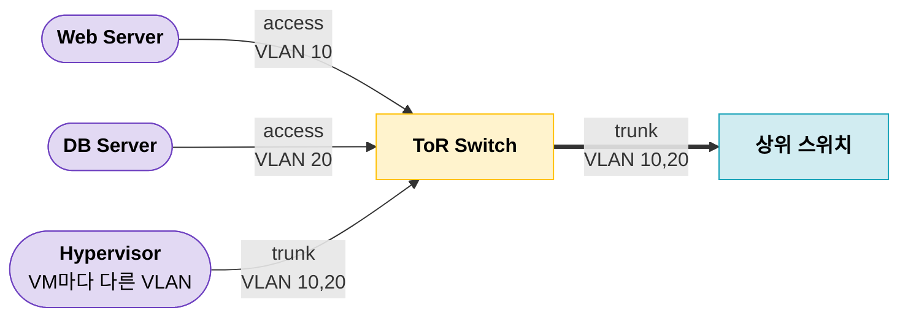

1편에선 랙에 서버와 스위치를 놓고 케이블을 연결하는 것까지 봤다. 이번엔 연결된 장비들이 같은 망 안에서 어떻게 프레임을 주고받는지 정리해보자.

## L2에서 알아둘 것

수업에서 배운 Ethernet 프레임, MAC 주소, 오류 검출(CRC)에 더해, 실제 망을 구성할 때는 VLAN과 이중화도 알아야 한다. 이 글에선 아래 순서로 살펴본다.

- 스위치의 프레임 전달과 IP에 대응하는 MAC 찾기 (MAC learning, ARP)
- 망을 어떻게 쪼개는지 (VLAN)
- 링크와 스위치를 어떻게 이중화하는지 (LACP, MLAG)

## 스위치는 어떻게 프레임을 보내나

L2에서 주고받는 단위는 Ethernet 프레임이다.

```text
+---------+---------+-----------+--------------+-----+
| Dst MAC | Src MAC | EtherType | Payload      | FCS |
|   6B    |   6B    |    2B     | 46 ~ 1500B   | 4B  |
+---------+---------+-----------+--------------+-----+
```

Payload 최대 1500B가 흔히 말하는 MTU다. (DC 안에선 9000B jumbo frame도 많이 쓴다)

스위치는 프레임이 들어온 포트와 src MAC을 MAC table에 기록한다. 이후 프레임을 보낼 때는 dst MAC을 이 테이블에서 찾는다.



![[Pasted image 20261018133046.png]]

그림에서 PC1이 PC4로 보내면 스위치는 MAC table의 `b29ac0 → port 4`를 보고 해당 포트로 전달한다. 이 L2 전달 과정에서 기준이 되는 건 목적지 MAC이다. 아직 배운 적 없는 MAC이거나 broadcast라면 같은 VLAN의 다른 포트로 flood한다.

---

## ARP: IP로 MAC 찾기

서버에서 통신할 때는 보통 상대 IP를 지정한다. 그런데 Ethernet 프레임을 만들려면 목적지 MAC도 필요하다. IPv4에서 이 MAC을 알아내는 데 ARP를 쓴다.



상대가 다른 대역이면 상대 MAC이 아니라 gateway MAC을 찾는다.

```text
dst IP       ARP target
10.0.0.2     10.0.0.2     같은 대역 -> 직접
8.8.8.8      10.0.0.254   다른 대역 -> gateway로
```

예를 들어 `8.8.8.8`로 보내는 패킷은 목적지 IP를 그대로 두고, 프레임의 목적지 MAC에 gateway MAC을 넣는다.

```text
dst MAC = gateway MAC   (바로 다음 hop, hop마다 바뀐다)
dst IP  = 8.8.8.8       (최종 목적지, 안 바뀐다)
```

gateway가 이 패킷을 다음 구간으로 넘길 때는 그 구간에 맞는 MAC으로 새 프레임을 만든다. 그래서 경로를 따라가면 MAC은 바뀌지만, 목적지 IP는 유지된다. (중간에 NAT를 하는 경우는 별개다.)

### GARP

on-prem에서 keepalived(VRRP)로 서비스 VIP를 이중화할 때도 ARP를 신경 써야 한다. VIP가 backup으로 넘어가면서 사용하는 MAC까지 달라지면, 주변 장비의 ARP cache에 남은 예전 MAC이 문제가 된다. VIP는 새 서버에 있는데 트래픽은 계속 예전 서버로 갈 수 있다.

이때 VIP를 가져간 서버가 GARP(Gratuitous ARP)를 broadcast로 보내 새 MAC을 알린다.

```text
Before : 10.0.0.100 (VIP) -> aa:aa:aa  (Server A, master)
GARP   : "10.0.0.100 is at bb:bb:bb"   (Server B가 broadcast)
After  : 10.0.0.100 (VIP) -> bb:bb:bb  (Server B, 새 master)
```

일반적인 ARP 요청에 답하는 과정과 달리, GARP는 상대가 물어보기 전에 IP를 가진 쪽에서 먼저 보낸다.

---

## VLAN

ARP 같은 broadcast는 같은 L2 망 전체에 퍼진다. 웹 서버, DB, 관리용 장비가 전부 한 망에 있으면 서로 필요 없는 broadcast까지 받게 된다.

VLAN을 쓰면 스위치를 물리적으로 나누지 않고도 L2 망을 분리할 수 있다. 예를 들어 웹 서버는 VLAN 10, DB는 VLAN 20에 넣는 식이다.



VLAN마다 broadcast domain이 나뉘고, 보통 IP subnet도 VLAN과 1:1로 맞춘다. 위 그림에서 웹 서버가 보낸 ARP broadcast는 DB가 있는 VLAN 20으로 넘어가지 않는다.

스위치 사이에서 여러 VLAN의 프레임을 같은 링크로 보내려면 어느 VLAN 소속인지 구분해야 한다. 이때 쓰는 게 802.1Q tag다.

```text
untagged : [Dst MAC][Src MAC]                [EtherType][Payload][FCS]
tagged   : [Dst MAC][Src MAC][  802.1Q tag  ][EtherType][Payload][FCS]
                             |              |
                             TPID(0x8100) + PCP + DEI + VID(12bit) = 4B
```

| 항목     | Access port                 | Trunk port        |
| ------ | --------------------------- | ----------------- |
| 연결 대상  | 일반 서버                       | 스위치 ↔ 스위치, 하이퍼바이저 |
| VLAN 수 | 1개                          | 여러 개              |
| 프레임    | untagged (스위치가 tag를 붙이고 뗀다) | tagged            |

VID는 12bit이고, 일반적으로 사용할 수 있는 VLAN ID는 1 ~ 4094다. 고객마다 VLAN을 나눠주는 CSP에서는 이 개수가 제약이 될 수 있다. 다음 편에서 볼 VXLAN은 24bit 식별자를 써서 약 1600만 개의 망을 구분한다.

---

## LAG, MLAG: 링크와 스위치 이중화

LAG(Link Aggregation)는 물리 링크 여러 개를 논리 링크 하나로 묶는다. 묶음을 양쪽이 협상하는 프로토콜이 LACP(802.3ad)다.

일반적인 LAG는 장비 한 대와 다른 장비 한 대 사이의 링크를 묶는다. 케이블 하나가 빠지는 건 대비할 수 있지만, 상대 스위치 자체가 내려가면 모든 링크가 같이 끊긴다.

스위치 장애까지 대비하려면 서버를 서로 다른 스위치 두 대에 연결해야 한다. MLAG는 이 두 스위치를 서버에게 하나의 LAG 상대처럼 보이게 만든다. Cisco의 vPC처럼 벤더마다 부르는 이름은 다르다.


그림처럼 서버의 두 NIC를 각각 ToR A, B에 연결하고 bond로 묶어 LACP를 사용한다. 서버 입장에선 스위치 한 대와 LAG를 맺은 것처럼 동작하므로, 한쪽 스위치가 장애나 점검으로 내려가도 남은 링크를 쓸 수 있다.

```yaml
# /etc/netplan/01-bond.yaml
network:
  version: 2
  ethernets:
    eno1: {}
    eno2: {}
  bonds:
    bond0:
      interfaces: [eno1, eno2]
      parameters:
        mode: 802.3ad              # LACP
        lacp-rate: fast
        transmit-hash-policy: layer3+4
```

| 항목        | LAG (LACP)    | MLAG       |
| --------- | ------------- | ---------- |
| 링크        | 전부 active     | 전부 active  |
| 상대 스위치 장애 | 상대가 1대라 같이 끊김 | 남은 1대로 계속  |
| 묶는 범위     | 장비 1대 ↔ 1대    | 장비 1대 ↔ 2대 |

다만 10G 링크 두 개를 묶었다고 한 연결에서 20G를 쓸 수 있는 건 아니다. 위 설정은 flow별 hash로 보낼 링크를 고르기 때문에, 하나의 flow는 한 링크의 대역폭 안에서 전송된다. 여러 flow가 양쪽 링크로 나뉘어야 합산 대역폭을 활용할 수 있다.

Linux bond의 `layer3+4`는 src/dst IP와 src/dst port를 hash에 쓴다. 흔히 말하는 5-tuple에서 protocol을 뺀 네 가지다. ([Linux bonding 문서](https://docs.kernel.org/networking/bonding.html))

```text
flow 1  10.0.0.1:50001 -> 10.0.0.9:443  -> hash -> eno1
flow 2  10.0.0.1:50002 -> 10.0.0.9:443  -> hash -> eno2
flow 3  10.0.0.1:50003 -> 10.0.0.9:443  -> hash -> eno1
```

---

## 데이터센터에서 L2

이제 서버와 스위치 연결을 DC 전체로 넓혀보자. 아래는 Clos(leaf-spine) 구성이다.

![[Pasted image 20261018134738.png]]

- leaf: 서버가 붙는 ToR 스위치
- spine: 모든 leaf와 연결돼서 서로 다른 leaf 사이의 트래픽을 넘겨준다

L2 망을 넓힐수록 broadcast가 퍼지는 범위도 커진다. 여기서는 L2를 leaf에서 끝내고, leaf와 spine 사이는 L3로 라우팅하는 구성을 기준으로 본다.

그림의 VXLAN은 이렇게 나눈 L3 망 위에서 필요한 L2 망을 연결하는 데 쓴다. 다음 편에서 라우팅부터 살펴보고, VXLAN과 EVPN까지 이어서 정리해보자.

이전 글: [[L1 physical|L1 — 케이블과 물리 연결]] · 다음 글: [[L3 Network Layer|L3 — 라우팅과 데이터센터 네트워크]]
