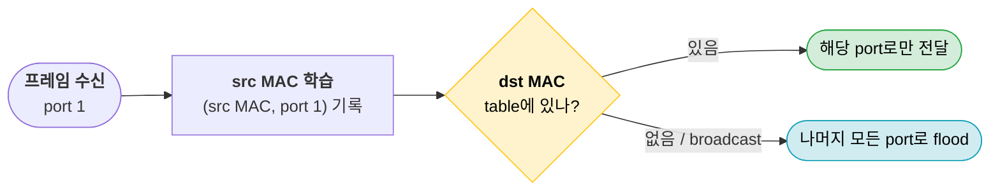
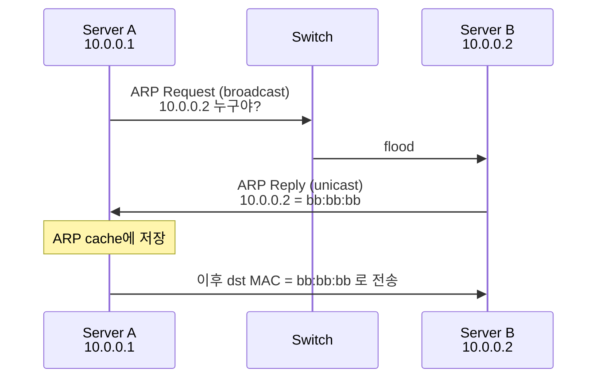
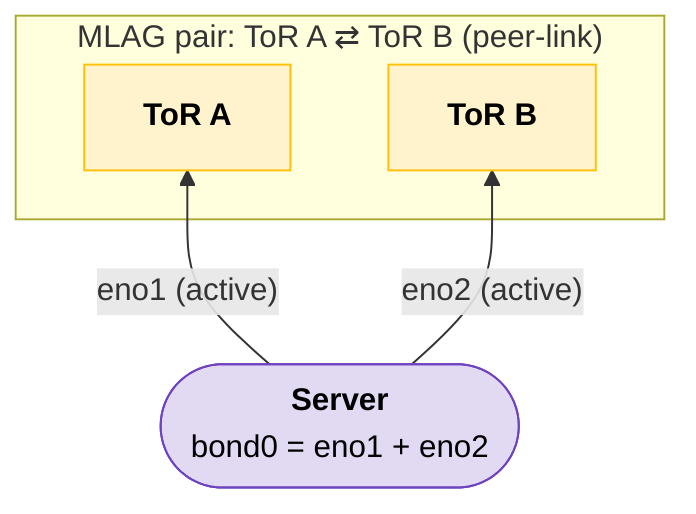

랙에 서버와 스위치를 놓고 케이블까지 다 꽂았다. 근데 아직 이 장비들끼리 통신은 안 된다.

2편은 L2, 같은 망 안에서 프레임을 주고받는 부분이다.

---

## L2, 뭘 알아야 하나

수업에선 L2를 Ethernet 프레임, MAC 주소, 오류 검출(CRC) 정도로 배운다. 실무에서 L2를 만질 일은 크게 세 가지다.

- 스위치가 프레임을 어떻게 보내는지 (MAC learning, ARP)
- 망을 어떻게 쪼개는지 (VLAN)
- 링크와 스위치를 어떻게 이중화하는지 (LACP, MLAG)

---

## 스위치는 어떻게 프레임을 보내나

L2에서 주고받는 단위는 Ethernet 프레임이다.

```text
+---------+---------+-----------+--------------+-----+
| Dst MAC | Src MAC | EtherType | Payload      | FCS |
|   6B    |   6B    |    2B     | 46 ~ 1500B   | 4B  |
+---------+---------+-----------+--------------+-----+
```

Payload 최대 1500B가 흔히 말하는 MTU다. (DC 안에선 9000B jumbo frame도 많이 쓴다)

스위치는 처음부터 누가 어느 포트에 있는지 알지 못한다. 프레임이 들어올 때마다 배운다.



![[Pasted image 20261018133046.png]]

PC1이 PC4로 보낼 때 스위치는 IP를 보지 않는다. MAC table에서 `b29ac0 → port 4`를 찾고 그쪽으로만 보낸다.

> 스위치는 src MAC으로 배우고, dst MAC을 보고 보낸다. 같은 subnet 안에선 IP가 아니라 MAC으로 통신한다.

---

## ARP: IP로 MAC 찾기

서버는 상대를 IP로 알고 있는데, 프레임을 보내려면 MAC이 필요하다. 이걸 이어주는 게 ARP다.



상대가 다른 대역이면 상대 MAC이 아니라 gateway MAC을 찾는다.

```text
dst IP       ARP target
10.0.0.2     10.0.0.2     같은 대역 -> 직접
8.8.8.8      10.0.0.254   다른 대역 -> gateway로
```

그래서 밖으로 나가는 프레임은 이렇게 생겼다.

```text
dst MAC = gateway MAC   (바로 다음 hop, hop마다 바뀐다)
dst IP  = 8.8.8.8       (최종 목적지, 안 바뀐다)
```

> MAC은 바로 다음 hop, IP는 최종 목적지다.

### GARP

on-prem에서 서비스 VIP를 keepalived(VRRP)로 이중화하면 ARP가 바로 골치 아파진다. master가 죽고 VIP가 backup으로 넘어가도, 주변 장비 ARP cache엔 옛날 MAC이 남아 있다.

그래서 VIP를 가져간 쪽이 묻지도 않았는데 GARP(Gratuitous ARP)를 broadcast로 쏴서 직접 알린다.

```text
Before : 10.0.0.100 (VIP) -> aa:aa:aa  (Server A, master)
GARP   : "10.0.0.100 is at bb:bb:bb"   (Server B가 broadcast)
After  : 10.0.0.100 (VIP) -> bb:bb:bb  (Server B, 새 master)
```

> ARP는 모르는 쪽이 묻고, GARP는 IP 주인이 먼저 알린다.

---

## VLAN

ARP 같은 broadcast는 같은 L2 망 전체에 뿌려진다. 웹 서버, DB, 관리망이 한 망에 있으면 broadcast도 다 같이 맞고, 서로 간 L2 통신을 제어하기도 어려워진다.

그래서 스위치 하나를 논리적으로 여러 L2 망으로 쪼갠다.


> VLAN 하나 = broadcast domain 하나. 보통 subnet 하나와 1:1로 맞춘다.

스위치끼리는 프레임에 VLAN 번호를 붙여서 보낸다. (802.1Q tag)

```text
untagged : [Dst MAC][Src MAC]                [EtherType][Payload][FCS]
tagged   : [Dst MAC][Src MAC][  802.1Q tag  ][EtherType][Payload][FCS]
                             |              |
                             TPID(0x8100) + PCP + DEI + VID(12bit) = 4B
```

| 항목     | Access port                 | Trunk port        |
| ------ | --------------------------- | ----------------- |
| 연결 대상  | 일반 서버                       | 스위치 ↔ 스위치, 하이퍼바이저 |
| VLAN 수 | 1개                          | 여러 개              |
| 프레임    | untagged (스위치가 tag를 붙이고 뗀다) | tagged            |

VID가 12bit라 쓸 수 있는 VLAN은 1 ~ 4094, 4094개가 한계다. 고객마다 VLAN을 하나씩 나눠주는 CSP라면 금방 바닥난다. 나중에 VXLAN(24bit, 약 1600만 개)이 나오는 이유다.

---

## LAG, MLAG: 링크와 스위치 이중화

LAG(Link Aggregation)는 물리 링크 여러 개를 논리 링크 하나로 묶는다. 묶음을 양쪽이 협상하는 프로토콜이 LACP(802.3ad)다.

근데 LAG는 장비 1대 ↔ 1대 사이에서만 묶인다. 상대 스위치가 한 대뿐이면 그 스위치가 SPOF다. 죽는 순간 같이 끊긴다.

그래서 스위치 두 대를 상대에게 한 대처럼 보이게 만든 게 MLAG다. (Cisco는 vPC, 벤더마다 이름이 다르다)



> 스위치 하나가 죽거나 점검으로 내려가도, 서버는 남은 링크로 계속 통신한다.

서버는 두 링크를 bond로 묶어서 LACP로 붙는다. 서버 입장에선 스위치 한 대랑 LAG를 맺은 것과 똑같다.

```yaml
# /etc/netplan/01-bond.yaml
network:
  version: 2
  ethernets:
    eno1: {}
    eno2: {}
  bonds:
    bond0:
      interfaces: [eno1, eno2]
      parameters:
        mode: 802.3ad              # LACP
        lacp-rate: fast
        transmit-hash-policy: layer3+4
```

| 항목        | LAG (LACP)    | MLAG       |
| --------- | ------------- | ---------- |
| 링크        | 전부 active     | 전부 active  |
| 상대 스위치 장애 | 상대가 1대라 같이 끊김 | 남은 1대로 계속  |
| 묶는 범위     | 장비 1대 ↔ 1대    | 장비 1대 ↔ 2대 |

묶었다고 대역폭이 그냥 두 배가 되진 않는다. 트래픽을 flow 단위로 hash해서 링크를 고른다. 흔히 5-tuple이라고 하지만, Linux bond의 `layer3+4`는 protocol을 빼고 src/dst IP, src/dst port 네 가지로 hash한다.

```text
flow 1  10.0.0.1:50001 -> 10.0.0.9:443  -> hash -> eno1
flow 2  10.0.0.1:50002 -> 10.0.0.9:443  -> hash -> eno2
flow 3  10.0.0.1:50003 -> 10.0.0.9:443  -> hash -> eno1
```

---

## 데이터센터에서 L2

> 그럼 실제 DC에선 L2를 어디까지 쓸까?

요즘 DC 토폴로지의 기본인 Clos(leaf-spine) 구성이다.

![[Pasted image 20261018134738.png]]

- leaf: 서버가 붙는 ToR 스위치
- spine: 모든 leaf와 연결돼서 leaf 간 트래픽을 넘겨준다. 서버 간(E-W)이든 외부로 나가는(N-S) 트래픽이든 spine을 거친다

L2를 넓게 펼칠수록 broadcast도 멀리 퍼진다. 그래서 L2는 leaf에서 끝내고, leaf 위로는 L3로 라우팅한다.

> L2는 랙 안(leaf)까지, 그 위는 L3다.

다음 편에선 L3 라우팅과, L3 위에 L2를 다시 얹는 VXLAN을 정리해보자.
