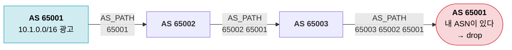
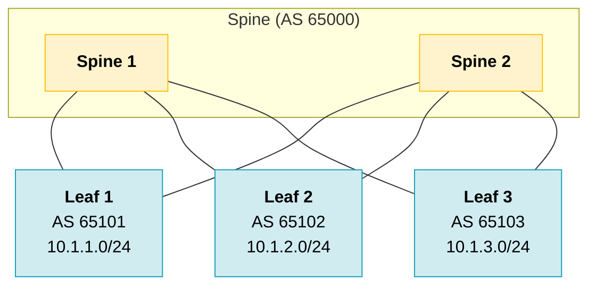
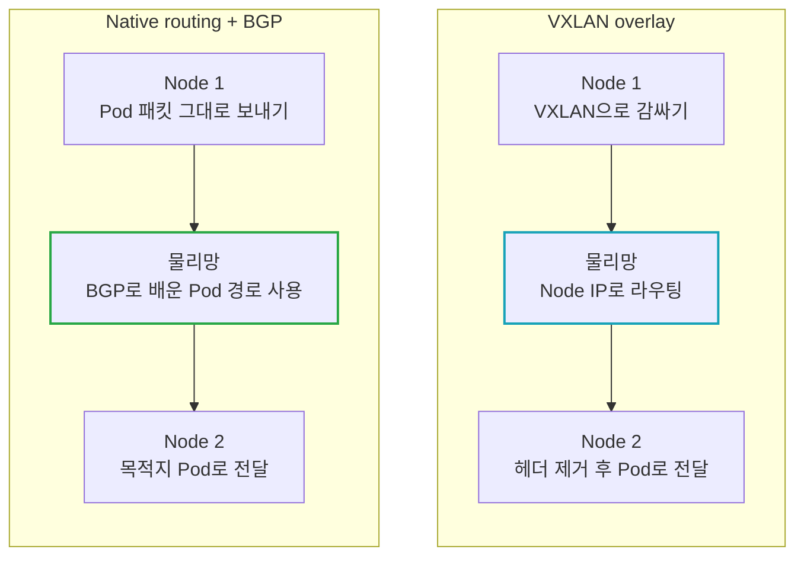

2편에선 L2를 leaf에서 끝내고, 그 위는 L3로 라우팅하는 구성을 봤다. 이번엔 그 라우팅이 어떻게 동작하는지 정리해보자.

L3는 네트워크를 구성하면서 알아둬야 할 게 가장 많은 부분이다. 우선 서버와 스위치의 routing table을 보고, 이 테이블을 채우는 BGP로 넘어간다. 뒤에서는 이걸 데이터센터의 Clos 구성과 VXLAN/EVPN, k8s 네트워크에 어떻게 쓰는지 살펴본다.

## 라우팅 테이블

라우팅은 패킷을 다음에 어디로 보낼지 정하는 과정이다. L3 스위치뿐 아니라 서버도 자기 routing table을 보고 패킷을 보낸다.

서버에서 `ip route`를 실행하면 아래처럼 확인할 수 있다.

```text
$ ip route
default via 10.1.1.1 dev bond0
10.1.1.0/24 dev bond0 proto kernel scope link src 10.1.1.11
```

이 서버는 `10.1.1.0/24`에 있는 상대라면 ARP로 MAC을 찾아 직접 보낸다. 그 밖의 목적지로 가는 경로는 따로 없으므로 default gateway인 `10.1.1.1`로 넘긴다.

L3 스위치는 경로가 훨씬 많다.

```text
Prefix         Next hop    Interface   Proto    AD
10.1.1.0/24    -           Vlan10      direct   0
10.1.2.0/24    10.0.0.1    Eth1/49     bgp      20
10.1.0.0/16    10.0.0.3    Eth1/50     static   1
0.0.0.0/0      10.0.0.1    Eth1/49     bgp      20
```

- Prefix: 목적지 대역
- Next hop / Interface: 다음에 넘길 장비와 나갈 포트
- Proto: 이 경로를 어디서 배웠는지 (direct, static, bgp ...)
- AD: 출처별 우선순위 (아래에서)

### Longest prefix match

목적지에 맞는 경로가 여러 개면, prefix가 가장 긴 경로를 고른다.

```text
dst = 10.1.2.15

10.1.1.0/24    x
10.1.2.0/24    O    /24   <- 선택
10.1.0.0/16    O    /16   (AD는 static이 더 좋지만 prefix가 짧다)
0.0.0.0/0      O    /0

O: 매칭  x: 불일치
```

위 예시에서 `10.1.2.15`는 `/24`, `/16`, `/0`에 모두 속하지만, 그중 범위가 가장 좁은 `10.1.2.0/24`를 선택한다. 이것이 longest prefix match다.

### Administrative Distance

같은 prefix를 static과 BGP 등 여러 출처에서 배울 수도 있다. 이때 어떤 출처의 경로를 routing table에 넣을지 비교하는 값이 AD다. 낮을수록 우선하며, 아래는 Cisco 기본값이다. 벤더마다 값은 다르다.

| 출처 | AD |
| --- | --- |
| connected (direct) | 0 |
| static | 1 |
| eBGP | 20 |
| OSPF | 110 |
| iBGP | 200 |

같은 프로토콜 안에서는 metric이나 해당 프로토콜의 경로 선택 규칙으로 비교한다. 동등한 경로가 여러 개 있고 장비가 multipath를 사용하도록 설정돼 있으면 next hop을 여러 개 둘 수 있다. 이게 뒤에서 볼 ECMP다.

헷갈리기 쉬운 부분은 AD와 prefix 길이를 한꺼번에 비교하는 것이다. AD는 **같은 prefix의 경로를 어느 출처에서 가져올지** 정할 때 쓰고, 실제 패킷을 보낼 때는 테이블에 있는 경로 중 longest prefix match로 고른다.

---

## 라우팅 프로토콜

장비가 몇 대 안 되면 필요한 경로를 static으로 넣어도 된다. 하지만 장비와 대역이 늘어나면 설정을 관리하기 어렵고, 장애가 났을 때 우회할 경로도 고려해야 한다. 라우팅 프로토콜을 쓰면 장비끼리 경로와 변경 사항을 주고받을 수 있다.

| 구분 | 대표 | 쓰는 곳 |
| --- | --- | --- |
| IGP | OSPF, IS-IS | 한 조직(AS) 안 |
| EGP | BGP | AS 간 (인터넷) |

여기서는 인터넷뿐 아니라 데이터센터 내부 구성에도 쓰는 BGP를 중심으로 본다.

---

## BGP

BGP(Border Gateway Protocol)는 AS 간 경로를 주고받는 프로토콜이다. AS(Autonomous System)는 하나의 관리 주체와 라우팅 정책 아래 있는 네트워크 묶음으로 보면 된다. 각 AS에는 ASN이라는 번호가 붙는다.

on-prem에서 공인 대역을 직접 운영한다면 ISP 두 곳과 BGP를 맺어 회선을 이중화하는 식으로 쓸 수 있다. 데이터센터 내부에서도 스위치 간 경로를 주고받는 데 사용한다.

- TCP 179로 이웃(peer)과 세션을 맺고, 처음엔 광고할 경로를 보내고 이후엔 변경 사항을 보낸다
- 정책으로 어떤 경로를 광고하고 받을지, 어느 쪽을 선호할지 세밀하게 정할 수 있다
- 경로마다 거쳐온 AS 목록(AS_PATH)을 붙여서 루프를 막는다



그림에서 AS 65001이 받은 경로에는 이미 자기 ASN이 들어 있다. 기본적으로 이런 경로는 루프가 생길 수 있어 받아들이지 않는다.

같은 AS 안에서 맺는 BGP 세션은 iBGP, 서로 다른 AS 사이에서 맺는 세션은 eBGP라고 한다.

### DC 내부에서 BGP 쓰기

한 조직 안의 라우팅이라면 OSPF 같은 IGP가 먼저 떠오르지만, DC 내부를 여러 AS로 나눠 eBGP로 연결할 수도 있다. OSPF와 비교하면 경로 정보를 다루는 방식이 다르다.

| 항목 | OSPF | BGP |
| --- | --- | --- |
| 방식 | link-state: 같은 area 안에서 토폴로지 정보를 공유 | path-vector: 이웃과 경로 및 속성을 교환 |
| 링크 변화 | area 전체로 flooding, 각자 SPF 재계산 | 영향받는 prefix만 update / withdraw |
| 정책 제어 | 제한적 | prefix, AS_PATH 단위로 세밀하게 |
| 구성 시 고려할 것 | area 설계와 토폴로지 변경에 따른 계산 | ASN 배치와 경로 광고 정책 |

규모가 커지면 토폴로지 변경을 전파하고 경로를 다시 계산하는 부담도 고려해야 한다. BGP는 prefix별 광고 정책을 제어하기 좋고, Clos처럼 반복되는 구조에 적용하기도 편하다. 대규모 DC에서 eBGP로 망을 구성하는 예와 설계 배경은 [RFC 7938](https://www.rfc-editor.org/rfc/rfc7938)에 정리돼 있다.

---

## Clos에서 L3: BGP + ECMP

2편 마지막에 본 Clos 구성에 ASN과 각 랙의 대역을 붙여보자. 여기서 leaf와 spine으로 구성한 망을 fabric이라고 부른다.



- leaf-spine 링크마다 eBGP 세션을 맺는다
- 이 예시에서는 spine에 같은 ASN을, leaf마다 서로 다른 ASN을 쓴다 (64512 ~ 65534 범위의 사설 ASN 사용)
- leaf는 자기 랙 대역만 광고한다

그러면 Leaf 1의 routing table은 이렇게 된다.

```text
10.1.1.0/24    direct                  내 랙
10.1.2.0/24    via Spine1, Spine2      AS_PATH 65000 65102 (ECMP)
10.1.3.0/24    via Spine1, Spine2      AS_PATH 65000 65103 (ECMP)
```

Leaf 1은 `10.1.2.0/24`로 가는 경로를 두 spine에서 받는다. 두 경로의 AS_PATH는 같고 next hop만 다르다. 다른 경로 속성도 ECMP 조건을 만족하고 BGP multipath가 설정돼 있으면, 두 next hop을 함께 쓸 수 있다. 트래픽은 2편의 LAG처럼 보통 flow별 hash로 나눈다.

Spine 1이 죽으면 BGP 세션이 끊기면서 그쪽 경로가 빠지고, 남은 spine으로만 보낸다.

spine을 추가하고 각 leaf를 연결하면 leaf 사이에서 사용할 경로와 합산 대역폭을 늘릴 수 있다. 다만 LAG와 마찬가지로 한 flow의 속도가 모든 경로의 대역폭을 합친 만큼 나오는 건 아니다.

---

## VXLAN, EVPN

L2를 leaf에서 끝내면 랙마다 망이 나뉜다. 그런데 VM의 IP를 유지한 채 다른 랙으로 옮기거나(live migration), 고객 망 하나를 여러 랙에 걸쳐 구성해야 할 때는 같은 L2가 필요할 수 있다.

VXLAN은 이런 L2 프레임을 L3 망 위의 터널로 전달한다. 물리망은 계속 L3로 라우팅하면서, 필요한 서버들은 같은 L2 망에 붙일 수 있다.

![[Pasted image 20261018143540.png]]

그림에서 먼저 구분할 건 검은 실선과 주황 점선이다.

- **검은 실선은 underlay**다. leaf와 spine을 실제로 연결한 L3 망이고, 앞에서 본 BGP와 ECMP를 여기에 쓸 수 있다.
- **주황 점선은 overlay**다. leaf 사이에 만든 논리적인 VXLAN 터널이다. 점선처럼 별도 케이블을 연결하는 게 아니라, 실제 패킷은 검은 실선을 따라 spine을 거쳐 간다.

각 leaf 아래에는 VLAN 11과 VLAN 12에 속한 VM이 있다. VLAN 11의 VM들은 서로 다른 leaf에 연결돼 있어도 `10.1.1.0/24`를 함께 쓰고, VLAN 12의 VM들은 `10.1.2.0/24`를 쓴다. 여기 적힌 IP는 VM의 주소이고, underlay에서 터널 양 끝을 연결하는 VTEP IP는 그림에 생략돼 있다.

VXLAN에서는 망을 구분할 때 VLAN ID 대신 **VNI(VXLAN Network Identifier)**를 사용한다. 그림에는 VNI가 없으니, 여기서는 설명을 위해 아래처럼 매핑했다고 하자.

| VM이 연결된 VLAN | VM 대역 | VXLAN VNI (예시) |
| --- | --- | --- |
| VLAN 11 | 10.1.1.0/24 | 10011 |
| VLAN 12 | 10.1.2.0/24 | 10012 |

이제 Leaf1 아래의 `10.1.1.10`이 Leaf3 아래의 `10.1.1.12`로 보내는 경우를 따라가 보자. 목적지 MAC과 목적지 VTEP은 이미 알고 있다고 가정한다.

1. `10.1.1.10`은 같은 대역의 VM으로 보내는 Ethernet 프레임을 만든다. Leaf1은 VLAN 11에서 들어온 이 프레임을 VNI `10011`의 VXLAN 패킷으로 감싼다. 바깥 IP 헤더의 목적지는 Leaf3의 VTEP IP다.
2. 패킷은 underlay의 라우팅 결과에 따라 Spine1 또는 Spine2를 거쳐 Leaf3으로 간다. spine은 바깥 IP 헤더로 라우팅하므로 VM의 MAC이나 VLAN을 보고 경로를 고를 필요가 없다.
3. Leaf3은 바깥 헤더를 벗기고, VNI `10011`에 해당하는 L2 망으로 원본 프레임을 전달한다. 목적지 VM `10.1.1.12`는 일반 Ethernet 프레임을 받는다.

여기서 패킷을 감싸고 벗기는(encap/decap) 역할을 하는 지점이 **VTEP(VXLAN Tunnel Endpoint)**이다. 이 그림에서는 leaf가 VTEP을 맡고, spine은 그 사이의 IP 패킷을 전달한다. Leaf1이 만든 패킷을 펼쳐보면 아래와 같다.

```text
Outer Ethernet
└─ Outer IP: Leaf1 VTEP IP → Leaf3 VTEP IP
   └─ UDP: dst port 4789
      └─ VXLAN: VNI 10011
         └─ 원본 Ethernet 프레임
            └─ Inner IP: 10.1.1.10 → 10.1.1.12
               └─ payload
```

VLAN 12의 트래픽도 같은 물리 링크를 쓸 수 있지만, VNI `10012`로 구분되므로 VLAN 11의 L2 망과 섞이지 않는다. 서로 다른 VNI의 망 사이에서 통신하려면 별도의 L3 라우팅이 필요하다. VNI는 24bit라 2편에서 본 VLAN보다 훨씬 많은 망을 구분할 수 있다.

바깥 IP가 IPv4이고 추가 VLAN tag가 없다면 encapsulation으로 50B가 늘어난다. 원래 IP 패킷 1500B를 그대로 보내려면 물리망의 IP MTU는 최소 1550B가 필요하다. VXLAN을 구성할 때 터널 설정과 함께 MTU도 맞춰야 하는 이유다. 헤더 형식과 MTU 관련 내용은 [RFC 7348](https://www.rfc-editor.org/rfc/rfc7348)에 나온다.

### EVPN

앞에서는 Leaf1이 목적지 MAC과 VTEP을 이미 안다고 가정했다. 실제로 보내려면 `10.1.1.12` VM의 MAC이 Leaf3 뒤에 있다는 정보를 어디선가 얻어야 한다.

VXLAN의 flood & learn 방식에서는 모르는 MAC으로 가는 프레임을 같은 VNI에 참여하는 VTEP들로 flood하고, 돌아오는 트래픽에서 MAC을 배운다. 2편의 MAC learning을 터널 위에서 하는 셈이라 참여하는 VTEP이 많아지면 부담이 커진다.

EVPN을 쓰면 BGP로 MAC과 IP 정보를 광고할 수 있다. 위 그림에서는 Leaf3이 `10.1.1.12` VM의 정보를 같은 VNI에 참여하는 다른 VTEP에 알려준다. VM의 MAC을 예시로 `02:00:00:00:11:12`라고 하면 광고 내용은 아래처럼 볼 수 있다.

```text
Leaf3 --(BGP EVPN Route Type 2)--> Leaf1, Leaf2
  MAC      = 02:00:00:00:11:12 (예시)
  IP       = 10.1.1.12
  VNI      = 10011
  next hop = Leaf3 VTEP IP
```

이 정보를 받은 Leaf1은 해당 MAC으로 가는 프레임을 Leaf3 VTEP으로 보내면 된다는 걸 알 수 있다.

| 항목 | VXLAN (flood & learn) | VXLAN + EVPN |
| --- | --- | --- |
| MAC 학습 | 모르면 flood, 트래픽 보고 학습 | BGP로 미리 받음 |
| ARP | 같은 VNI의 VTEP들로 broadcast | 학습한 정보가 있으면 leaf가 대신 응답 가능 (ARP suppression) |
| control plane | 없음 | BGP |

실제 프레임을 실어 나르는 VXLAN을 data plane, 어디로 보낼지 정보를 주고받는 EVPN을 control plane이라고 구분하면 두 역할을 이해하기 쉽다.

---

## k8s에서 Pod 대역 연결하기

일반적인 서버 구성에서는 서버에 할당한 IP와 랙 대역을 기준으로 라우팅하면 된다. k8s를 올리면 같은 물리 서버 위에 Pod별 IP가 추가된다. Pod가 생성되거나 다른 노드에 다시 만들어지면 통신해야 할 대상도 바뀐다.

그래서 Node IP 사이의 통신뿐 아니라 Pod 대역을 어떻게 연결할지도 정해야 한다. 여기서는 VXLAN overlay와 BGP를 이용한 native routing 두 구성을 비교해보자.

- **Overlay**: 노드 사이에 VXLAN 터널을 만든다. 물리망은 Node IP로 라우팅하고, Pod 패킷은 터널 안에 넣어 보낸다.
- **Native routing + BGP**: Pod 패킷을 터널로 감싸지 않고 라우팅한다. 노드는 leaf에 BGP로 Pod 대역을 광고해 경로를 알려준다.



두 경우 모두 물리망을 지나지만, 물리망이 라우팅할 때 보는 목적지 IP가 다르다. 이 차이는 leaf의 routing table에서도 확인할 수 있다. ([Cilium 라우팅 문서](https://docs.cilium.io/en/stable/network/concepts/routing/))

```text
[overlay]
10.1.1.0/24      direct
                 (Pod 대역은 모른다. 터널 안에 숨어 있다)

[BGP]
10.1.1.0/24      direct
10.244.1.0/24    via 10.1.1.11          Node 1이 광고한 Pod 대역
10.244.2.0/24    via 10.1.1.12          Node 2가 광고한 Pod 대역
10.100.0.10/32   via 10.1.1.11, .12     MetalLB가 광고한 Service VIP (ECMP)
```

위 예시의 마지막 줄은 Pod 대역과 별개로 MetalLB가 광고한 Service VIP다. MetalLB를 BGP 모드로 쓰고 여러 노드가 같은 `/32`를 광고하면, multipath가 설정된 leaf에서 노드들로 트래픽을 분산할 수 있다. 실제 분산 방식은 라우터 설정에 따라 달라진다. ([MetalLB BGP 모드 설명](https://metallb.io/concepts/bgp/))

| 항목 | 일반 서버 | k8s VXLAN overlay | k8s native routing + BGP |
| --- | --- | --- | --- |
| 물리망이 아는 IP | 서버 IP | Node IP | Node IP + Pod 대역 |
| 서버/Pod 간 통신 | IP 라우팅 | 노드 간 VXLAN 터널 | Pod IP로 라우팅 |
| 물리망 설정 | 대역 할당과 라우팅 | Node 간 연결, 터널 허용, MTU | Pod 경로 수용, BGP peering과 정책 |
| 예시 | - | Flannel VXLAN, Cilium VXLAN 모드 | Calico BGP, Cilium native routing + BGP |

여기서 BGP와 native routing을 같은 기능으로 생각하면 헷갈린다. BGP는 경로를 알려주는 수단이고, 패킷을 실제로 전달하는 설정은 별도로 필요하다. 예를 들어 Cilium의 BGP control plane은 경로를 광고하지만 datapath 자체를 설정하지는 않는다. ([Cilium BGP 문서](https://docs.cilium.io/en/stable/network/bgp-control-plane/bgp-control-plane/))

다음 편에서는 L4로 올라가 TCP/UDP와 L4 LB를 정리해보자.

